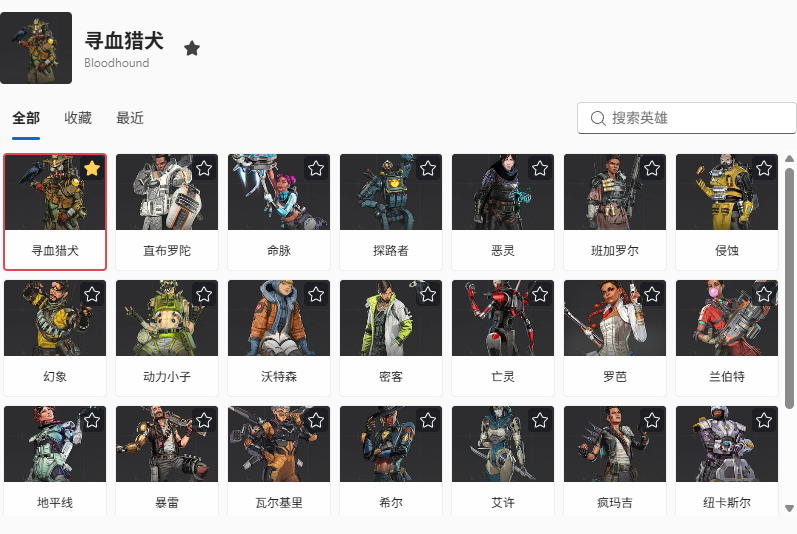
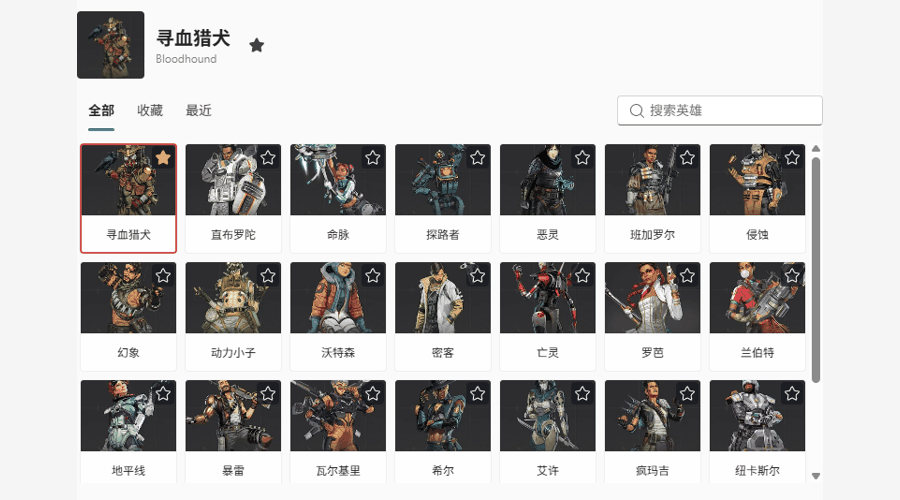

# ApexPing

Windows 桌面 Apex 风格标记轮盘，基于 [darrenprx/lolPing](https://github.com/darrenprx/lolPing) 改造。当前开发版本：0.4.0。

这是独立桌面覆盖层，不注入游戏进程，不向 Apex 游戏内发送标记。

[下载最新正式版](https://github.com/5434945/ApexPing/releases/latest) · [更新说明](CHANGELOG.md)





## 0.4.0 新功能

- 28 位英雄头像网格，中英文搜索、收藏及最近使用；头像来自 [EA 官方英雄页](https://www.ea.com/games/apex-legends/apex-legends/game-objects/characters-hub)，逐项来源记录在 `assets/legend-portraits.json`。
- 按标记动作逐条试听，收藏或屏蔽语音。“精选”优先播放收藏；没有收藏时按原始情境标签和时长使用最多 5 条语音，并非人工逐条听审。
- 可选语音响度均衡：根据原始音频测量结果调整播放增益，并限制峰值；不重写 OGG 音频或游戏文件。
- 可调整轮盘大小、不透明度、中心取消范围、扇区边界容错；设置页带实时预览。屏幕边缘完整显示轮盘，标记位置保持在呼出点。
- 完整离线版继续保留；基础版不含语音，可单独导入中文或英文包。每条文件通过原始导出 SHA-256 校验后安装到 `%APPDATA%\ApexPing\voice-packs`，失败时保留已安装语音。

语音包用法：先解压 `ApexPing-0.4.0-voices-zh-CN.zip` 或 `ApexPing-0.4.0-voices-en.zip`，在“英雄与语音”底部导入包含 `apexping-voice-pack.json` 的文件夹。完整离线版不需要这一步。

## 操作

- 按住 Alt 并移动鼠标打开轮盘，指向选项后松开 Alt 发送标记。
- 回到中心后松开取消；Alt + 左键快速发送普通标记。
- Ctrl + Alt + P 开关标记功能；托盘菜单提供设置与退出。
- 可调整触发键、轮盘项目、音量、大小和持续时间。
- 默认在全屏应用中暂停触发，先在普通桌面上测试。

## 当前实现

- 默认八方向轮盘按用户提供的游戏截图还原，采用半透明灰色扇区、橙白选中弧线和中央名称；敌人声音、避开区域和集合仍可配置。桌面标记不显示下方文字。
- 使用本机 Apex 游戏文件中的原版图标和提示音源；映射记录在 `assets/apex-provenance.json`。
- 全部 28 位英雄，普通话 / 英语切换，语音音量独立设置。12 个标记项、672 个英雄/语言/动作组合，共 13,637 条有效语音变体；打乱播放且避免连续重复。逐条来源及 SHA-256 见 `assets/voice-manifest.json`。
- 动画为桌面端重现，不是游戏动画逐帧复制；通用提示音使用原版源片段，尚未复刻完整游戏事件混音。
- 删除表情入口、设置、导入、播放模块及打包素材；旧表情消息会被拒绝。
- 房间标记携带发送方英雄身份，接收方选择听中文或英文。旧客户端无英雄身份时不猜测角色、不播放错误角色语音。
- 房间密钥命名空间与 lolPing 隔离；双方需使用此版本。自动更新默认关闭。
- 配置使用 `%APPDATA%\ApexPing`，默认不开机启动。

## 开发与构建

Windows x64，Node.js 22 或更高版本，以及带 C++ 桌面开发工具的 Visual Studio Build Tools。

```powershell
npm ci
npm run build:helper
npm run typecheck
npm test
npm run dev
```

构建安装包：`npm run dist`。生产构建：`npm run build`。项目不提交 `node_modules`、`out`、`release` 或原生编译产物。

完成 Windows 解包构建后，运行 `npm run package:editions` 生成完整离线版、基础版和双语分包 ZIP。语音文件使用 `asarUnpack`，便于基础版通过独立语音包补全。

## 验证状态

验证记录见交付目录的测试与界面检查报告。类型检查、自动化测试、浏览器渲染检查和原生桌面实测是不同层级，不能互相替代。尚不能宣称真实桌面热键、多显示器、扬声器音质或跨设备同步全部完成实测。

## 许可证与素材

代码沿用上游 MIT 许可证，保留 [LICENSE](LICENSE) 和原作者 Danrui Meng 的版权声明。上游说明保存在 [docs/UPSTREAM_README.md](docs/UPSTREAM_README.md)。

Apex Legends 图标和音频归 EA / Respawn 及各自权利人所有。MIT 许可证不授予这些游戏素材的权利。公开资料用于核对；双语原声来自本机已安装游戏，不是从公开网站下载的完整语音库。详见 [素材核对记录](docs/APEX_REFERENCE.md)。发布原版素材前应单独确认适用许可。

This project is not endorsed by or affiliated with EA or its licensors.
